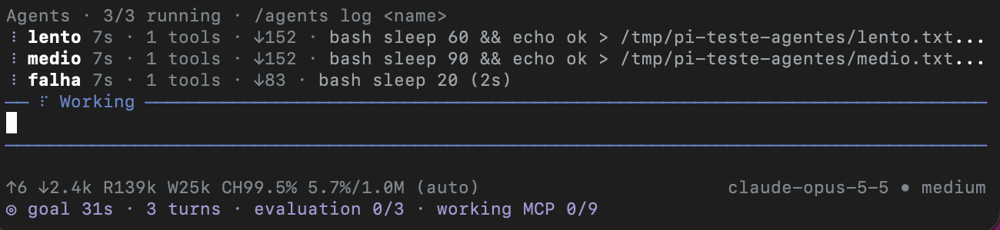

# pi-background-agents

[](https://github.com/rafae2k/pi-background-agents/actions/workflows/ci.yml)
[](LICENSE)

Background subagents with a live progress panel, and a `/goal` loop that waits for them, for the [pi coding agent](https://github.com/badlogic/pi-mono).



You start agents, you keep talking to pi, and you can always see what each one is doing right now. Open any agent to read its conversation live, send it a message, or stop it.

## Install

```bash
pi install git:github.com/rafae2k/pi-background-agents
```

Then run `/reload` in any open session. To try it for one session without installing:

```bash
pi -e git:github.com/rafae2k/pi-background-agents
```

Requires Node 24 or newer. Tested on pi 1.4.0.

## Quick start

Ask for parallel work in plain language:

```text
Use dispatch_agent to start three agents: one to fix the failing auth tests,
one to update the API docs, one to review the migration. Give each its own brief.
```

Or set a goal and let pi work until it is met:

```text
/goal --check "npm test" Migrate the auth module to the new API until every test passes
```

## Managing agents

| Command                      | What it does                                        |
| ---------------------------- | --------------------------------------------------- |
| `/agents`                    | Pick an agent from a list and open it               |
| `/agents open <name>`        | Open the live view of one agent                     |
| `/agents send <name> <text>` | Message a running agent, or continue a finished one |
| `/agents stop <name\|all>`   | Stop one agent or all of them                       |
| `/agents log <name>`         | Print the agent's recent activity                   |
| `/agents status`             | One line per agent                                  |

Inside the live view:

| Key                   | What it does                                                                                                                                                                         |
| --------------------- | ------------------------------------------------------------------------------------------------------------------------------------------------------------------------------------ |
| Type, then `Enter`    | Message the agent. A running agent reads it after its current tool. A finished or stopped agent continues in its own session, and its new report comes back to the main conversation |
| `Ctrl+X` twice        | Stop the agent                                                                                                                                                                       |
| `↑` `↓` `PgUp` `PgDn` | Scroll                                                                                                                                                                               |
| `Esc`                 | Go back. The agent keeps running                                                                                                                                                     |

## What you see

**The panel** sits above the editor while agents run. Each line shows elapsed time, tool calls, output tokens and the current action. A queued agent says it is waiting for a slot. If an agent goes quiet for 3 minutes outside a tool, its line turns yellow, so slow and stuck look different. Long-running tools don't trigger the warning.

**The conversation** stays yours. `dispatch_agent` returns immediately. Each report arrives on its own as a compact card, and starts a new turn so the main agent can act on it. `Ctrl+O` expands a card.

**Esc in the main session** stops the main agent's turn, not the subagents.

## `/goal`

```text
/goal [--check "<shell command>"] [--max N] <objective>
/goal             show status and the last verdict
/goal stop        pause
/goal resume      resume
```

When the main agent is about to stop, the goal is evaluated:

1. The `--check` command, if given, must exit 0.
2. A judge using the current model reads the objective and the end of the transcript, and decides whether the evidence proves completion.

If the goal isn't met, the reason is sent back and pi continues, up to `--max` times (10 by default). The agent can write `BLOCKED: <question>` to pause and ask you.

The footer shows the state at all times:

```text
◎ goal 12m04s · 34 turns · evaluation 2/10 · waiting for 2 agent(s)
```

While subagents run, the goal only waits. Their reports start a new run, and that run is the one judged.

The two extensions work apart too. `/goal` needs nothing from `dispatch_agent`.

## Configuration

| Setting                  | Default | Meaning                                              |
| ------------------------ | ------- | ---------------------------------------------------- |
| `PI_AGENTS_MAX_PARALLEL` | `3`     | Agents running at once. Extra agents wait for a slot |

Per agent, `dispatch_agent` also takes `cwd`, `model`, `thinking`, `timeout_minutes` (45 by default) and `resume_session`. An agent uses the current model unless it names another.

## How it works

Each agent is a separate `pi --mode rpc` process with its own persisted session. Its event stream feeds the panel and the live view, and its stdin carries your messages. Full reports are saved to `pi-agents/` in the system temp directory.

Print and JSON modes have no one to deliver a later report to, so there the tool waits for all agents and returns their reports together.

### Why a single call with an array

The tool takes `agents: [...]` instead of one call per agent because of how [pi-claude-bridge](https://github.com/vanillagreencom/kendex/tree/main/pi-extensions/pi-claude-bridge) ends a turn. About 6 seconds after the first tool call is ready, it ends the turn and prunes sibling calls whose arguments are still streaming. A long brief loses that race every time, so calls that look parallel run one after the other and leave an empty card on screen. With one call there is no sibling to prune. It's also why the judge passes `cacheRetention: "none"`: the bridge reads it as "no tools by design", and otherwise the judge would receive Claude Code's own shell and file tools.

## Limitations

- **Agents end with the session.** Closing pi, `/new` and `/reload` stop running agents. Their sessions are saved, so they can be continued with `resume_session`.
- **Agents share the working tree** unless you give each one its own git worktree through `cwd`. Give parallel agents separate files.
- **Agents can't start agents.** Subagents don't get the tool, which rules out runaway fan-out.
- **Dialogs are cancelled in agents.** A subagent has no one to answer an extension's prompt, so it receives a cancel.
- **The live view holds the last 1,000 entries**, and it is lost when the session ends. The saved session and report remain.

## Alternatives

If you want more, such as a navigable agent list under the editor, custom agent types or scripted workflows, look at [tintinweb/pi-subagents](https://github.com/tintinweb/pi-subagents). This package is deliberately small: two extensions, no runtime dependencies, one process per agent.

## Security

Agents run with the same permissions as pi, and they inherit your trust decision for the project. Read a brief as you would any instruction you hand to an agent with shell access. See [SECURITY.md](SECURITY.md).

## Contributing

See [CONTRIBUTING.md](CONTRIBUTING.md). Issues and pull requests are welcome.

## License

[MIT](LICENSE)
